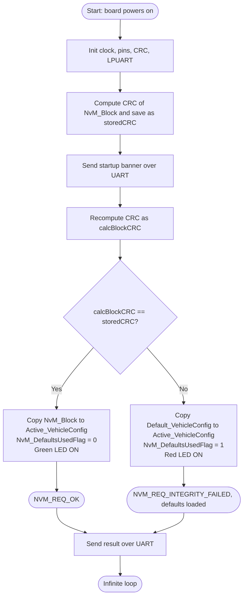

# NvM Default Value Fallback with CRC Check

Embedded C | S32 Design Studio | CRC | UART | LED

A small embedded project that protects a vehicle configuration block against corruption. The block is stored in a simulated NvM area together with a **CRC** check code. At start-up the program re-calculates the CRC. If the block is damaged and **no redundant copy exists**, it loads a **compile-time default configuration** into RAM instead of leaving it uninitialized, and notifies the application with `NvM_DefaultsUsedFlag = 1`. All steps are printed over UART so they can be watched in PuTTY.

---
## Table of contents

| No. | Section | What it covers |
|---|---|---|
| 1 | [What this project does](#1-what-this-project-does) | Purpose and basic idea |
| 2 | [Requirements and scope](#2-requirements-and-scope) | Requirements R1 to R5 |
| 3 | [How it works](#3-how-it-works) | Flowchart and step-by-step logic |
| 4 | [Data and memory map](#4-data-and-memory-map) | Structure, default values and NvM test data |
| 5 | [Status codes and flag](#5-status-codes-and-flag) | `NVM_REQ_OK`, `NVM_REQ_INTEGRITY_FAILED`, `NvM_DefaultsUsedFlag` |
| 6 | [Hardware and software used](#6-hardware-and-software-used) | Board, tools |
| 7 | [Project structure](#7-project-structure) | Folders and files |
| 8 | [Configuration](#8-configuration) | Macros, components, PuTTY settings |
| 9 | [How to build and run](#9-how-to-build-and-run) | Build, flash and test steps |
| 10 | [Test cases](#10-test-cases) | TC1 to TC3 |
| 11 | [Sample UART output](#11-sample-uart-output) | Expected PuTTY output |
| 12 | [Code overview](#12-code-overview) | Functions and messages |
| 13 | [Limitations and future work](#13-limitations-and-future-work) | Known gaps and improvements |
| 14 | [Author](#14-author) | Name, institution |
---

## 1. What this project does

Data stored in non-volatile memory can become corrupted (power loss during a write, noise, wear). A common protection is to store a **CRC** (a number calculated from the data) with each block. If the data is changed or damaged, the recalculated CRC no longer matches the stored one.

In this project:

- **`NvM_Block`** is the simulated NvM copy of the vehicle configuration (speed limit, temperature limit, minimum battery voltage, headlight mode).
- **`storedCRC`** is the CRC saved for that block.
- **`Default_VehicleConfig`** is a `const` default configuration stored in flash at compile time.
- **`Active_VehicleConfig`** is the RAM copy that the application uses.
- **`NvM_DefaultsUsedFlag`** tells the application which source was loaded: `0` = NvM data, `1` = defaults.

The program verifies the NvM block. If the CRC is correct, the block is copied to RAM. If not, and no redundant copy exists, the defaults are copied to RAM so the application never runs on uninitialized data.

## 2. Requirements and scope

| Rx | Requirement |
|---|---|
| R1 | Calculate and store the CRC of the NvM block (simulates the CRC saved at the last write). |
| R2 | At start-up, recalculate the CRC of the block and compare it with the stored CRC. |
| R3 | If the CRC fails and no redundant copy exists, load `Default_VehicleConfig` into `Active_VehicleConfig` instead of leaving it uninitialized. |
| R4 | Notify the application with `NvM_DefaultsUsedFlag = 1` when defaults are used (`0` when NvM data is valid). |
| R5 | Report the result over UART (`NVM_REQ_OK` / `NVM_REQ_INTEGRITY_FAILED`) and on the on-board LED. |

## 3. How it works



Step by step:

1. Initialise clock, pins, UART and the CRC module.
2. Calculate the CRC of `NvM_Block` and store it in `storedCRC`.
3. (Test only) Optionally corrupt the block with `NvM_Block.maxSpeedLimit ^= 0xFFFFU;`.
4. Print the start-up banner over UART and wait until it is sent.
5. Recalculate the CRC of `NvM_Block` into `calcBlockCRC`.
6. If `calcBlockCRC == storedCRC`, copy the NvM block to `Active_VehicleConfig`, set `NvM_DefaultsUsedFlag = 0`, turn the green LED on and report `NVM_REQ_OK`.
7. If they differ, copy `Default_VehicleConfig` to `Active_VehicleConfig`, set `NvM_DefaultsUsedFlag = 1`, turn the red LED on and report `NVM_REQ_INTEGRITY_FAILED`.
8. Send the result message over UART and stay in an infinite loop.


## 4. Data and memory map

The NvM block is **simulated in RAM** (a global variable), so there are no EEPROM addresses. The block is a `VehicleConfig_t` structure:

| Field | Type | Meaning |
|---|---|---|
| `maxSpeedLimit` | `uint16_t` | Speed limit in km/h |
| `engineTempLimit` | `uint8_t` | Engine temperature limit in °C |
| `minBatteryVoltage` | `uint16_t` | Minimum battery voltage in 0.1 V units (`120` = 12.0 V) |
| `headlightAutoMode` | `uint8_t` | `0` = OFF, `1` = ON |

| Variable | Location | Description |
|---|---|---|
| `Default_VehicleConfig` | Flash (`const`) | Compile-time default values |
| `NvM_Block` | RAM | Simulated NvM block |
| `storedCRC` | RAM | CRC saved for `NvM_Block` |
| `Active_VehicleConfig` | RAM | Configuration used by the application |
| `NvM_DefaultsUsedFlag` | RAM | `0` = NvM data used, `1` = defaults used |

### Test data

| Parameter | Default (`Default_VehicleConfig`) | NvM block (`NvM_Block`) |
|---|---|---|
| Max speed limit | 120 km/h | 100 km/h |
| Engine temperature limit | 105 °C | 100 °C |
| Minimum battery voltage | 12.0 V (`120`) | 11.5 V (`115`) |
| Automatic headlights | ON (`1`) | OFF (`0`) |

The two sets are **deliberately different**, so the UART output shows clearly which set was loaded.

## 5. Status codes and flag

| Status | Value | Meaning |
|---|---|---|
| `NVM_REQ_OK` | 0 | NvM block is valid. NvM data loaded into RAM. |
| `NVM_REQ_INTEGRITY_FAILED` | 2 | CRC mismatch. Defaults loaded into RAM. |

| Flag | Value | Meaning |
|---|---|---|
| `NvM_DefaultsUsedFlag` | 0 | Application is running on NvM data |
| `NvM_DefaultsUsedFlag` | 1 | Application is running on compile-time defaults |

### LED indication

| Result | PTD16 | PTD15 | Visible LED (S32K144EVB, active-low RGB) |
|---|---|---|---|
| CRC valid | 0 | 1 | Green ON |
| CRC failed | 1 | 0 | Red ON |

## 6. Hardware and software used

### Hardware

| Item | Details |
|---|---|
| Microcontroller board | `NXP S32K144 Development Board` |
| Connections | LPUART_1 TX/RX to the PC through USB-serial, on-board RGB LED on PTD15 / PTD16 |
| PC | Windows with a free COM port |

No external EEPROM or I2C wiring is needed, because the NvM block is simulated in RAM.

### Software

| Tool | Version / note |
|---|---|
| S32 Design Studio | `3.5.0.0` |
| PuTTY | `0.85` |

## 7. Project structure

```
nvm-default-value-fallback/
├── src/
│   └── main.c            Application: CRC check, default fallback, UART and LED output
├── docs/
│   ├── flowchart.png     Flowchart image
│   └── documentation.pdf Full project documentation
├── images/               PuTTY screenshots and board photos
└── README.md

```


## 8. Configuration

### 8.1 Compile-time switches (`main.c`)

| Macro / line | Default | Purpose |
|---|---|---|
| `LED_PORT` | `PTD` | Port of the LEDs |
| `LED_PIN` | `15U` | Red LED pin (the green LED uses pin `16U`) |
| `NvM_Block.maxSpeedLimit ^= 0xFFFFU;` | commented out | Uncomment to corrupt the block and test the CRC failure |
| `NVM_REQ_OK` | `0` | Status code for a valid block |
| `NVM_REQ_INTEGRITY_FAILED` | `2` | Status code for a failed CRC |

### 8.2 S32 Design Studio components

| Peripheral | Name used in code | Setting |
|---|---|---|
| Clock | `clockMan1_InitConfig0` | Enables the LPUART and CRC modules |
| Pins | `g_pin_mux_InitConfigArr0` | UART TX/RX and LED pins (PTD15, PTD16) |
| UART | `INST_LPUART_1`, `lpuart_0_InitConfig0` | Baud rate `<set yours, e.g. 115200>`, 8 data bits, no parity, 1 stop bit |
| CRC | `INST_CRC_1`, `crc_1_Cfg0` | 16-bit, polynomial `0x1021`, seed `0xFFFF`, no transpose, no complement (CRC-16/CCITT-FALSE) |

### 8.3 Data and CRC rules

| Item | Value |
|---|---|
| Block size | `sizeof(VehicleConfig_t)` (8 bytes on this 32-bit target, including padding) |
| CRC input | The whole `NvM_Block` structure |
| CRC result size | 16 bits, returned in a `uint32_t` (`storedCRC`, `calcBlockCRC`) |
| CRC peripheral | Re-initialised on every `CalculateBlockCRC()` call, so each result is independent |
| UART buffer | `txBuff[200]` |

### 8.4 PuTTY settings


## 9. How to build and run

1. Clone the repository and open it in S32 Design Studio (File > Import > Existing Projects into Workspace).
2. Make sure the S32 SDK is installed and the components in section 8.2 are configured.
3. Keep the line `//NvM_Block.maxSpeedLimit ^= 0xFFFFU;` **commented out** for the first test.
4. Build the project and flash it to the board.
5. Open PuTTY with the settings in section 8.4 and reset the board.
6. Check the first output (section 11.1) and the green LED.
7. Uncomment the line `NvM_Block.maxSpeedLimit ^= 0xFFFFU;`, rebuild and flash.
8. Reset the board and check the second output (section 11.2) and the red LED.

> **Note:** The NvM block is simulated in RAM, so nothing is stored permanently. Every reset starts with the same data and the result depends only on the corruption line.

## 10. Test cases

| ID | Setup | Expected behaviour | Expected status | Flag | LED |
|---|---|---|---|---|---|
| TC1 | Corruption line commented out | CRC matches, NvM data loaded into RAM | `NVM_REQ_OK` | `NvM_DefaultsUsedFlag = 0` | Green |
| TC2 | Corruption line enabled (`maxSpeedLimit ^= 0xFFFFU`) | CRC mismatch, defaults loaded into RAM | `NVM_REQ_INTEGRITY_FAILED` | `NvM_DefaultsUsedFlag = 1` | Red |
| TC3 (optional) | Corrupt another field, e.g. `NvM_Block.engineTempLimit ^= 0xFFU;` | CRC mismatch, defaults loaded into RAM | `NVM_REQ_INTEGRITY_FAILED` | `NvM_DefaultsUsedFlag = 1` | Red |

## 11. Sample UART output

### 11.1 Valid block (TC1)

```
--- ECU Startup: NvM CRC Check ---
NvM Block Valid: NVM_REQ_OK
Max Speed Limit: 100 km/h
Engine Temperature Limit: 100 C
Minimum Battery Voltage: 11.5 V
Automatic Headlights: OFF
Defaults Used: 0
```


### 11.2 Corrupted block (TC2)

```
--- ECU Startup: NvM CRC Check ---
CRC Failed: NVM_REQ_INTEGRITY_FAILED
Default configuration loaded into RAM
Max Speed Limit: 120 km/h
Engine Temperature Limit: 105 C
Minimum Battery Voltage: 12.0 V
Automatic Headlights: ON
Defaults Used: 1
LED ON
```


## 12. Code overview

| File | Function | Purpose |
|---|---|---|
| `main.c` | `main()` | Initialises peripherals, stores the CRC, re-checks it, loads NvM data or defaults, prints the result |
| `main.c` | `CalculateBlockCRC()` | Re-initialises the CRC module and returns the CRC of a data buffer |

### UART message reference

| Message | Meaning |
|---|---|
| `--- ECU Startup: NvM CRC Check ---` | Start-up banner |
| `NvM Block Valid: NVM_REQ_OK` | CRC matched, NvM data loaded |
| `CRC Failed: NVM_REQ_INTEGRITY_FAILED` | CRC mismatch |
| `Default configuration loaded into RAM` | Fallback to `Default_VehicleConfig` done |
| `Max Speed Limit / Engine Temperature Limit / ...` | Content of `Active_VehicleConfig` |
| `Defaults Used: n` | Value of `NvM_DefaultsUsedFlag` |
| `LED ON` | Red LED turned on after a CRC failure |

## 13. Limitations and future work

| Limitation | Possible improvement |
|---|---|
| NvM block is simulated in RAM | Read the block and its CRC from real EEPROM or flash |
| Only 1 fixed block | Make it a configuration-driven table of many blocks |
| No redundant copy | Add a mirror copy and try it before falling back to defaults |
| Defaults are not written back to NvM after the fallback | Write the defaults and a new CRC to NvM after recovery |
| CRC covers padding bytes of the structure | Use a packed structure or calculate the CRC field by field |
| `NVM_REQ_*` codes are only used in messages | Store the result in a status variable, as in AUTOSAR NvM |
| `CalculateBlockCRC()` returns `0` on init failure, which can also be a valid CRC | Return a separate status value |
| Program stops in an endless loop after the test | Run the check periodically or on request |

## 14. Author

| | |
|---|---|
| Name        | `SUMITH DANI M` |
| Institution | `SAVEETHA ENGINEERING COLLEGE` |
